<p align="center">
  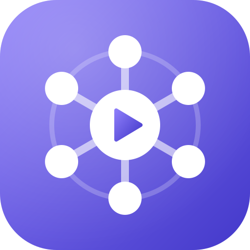
</p>

<h1 align="center">Hubarr</h1>

<p align="center">
  <strong>Votre stack média, au même endroit.</strong><br />
  Radarr, Sonarr, Prowlarr, Bazarr, Seerr, clients de téléchargement, Tautulli, Emby… pilotés depuis une seule interface, sur mobile comme sur ordinateur.
</p>

<p align="center">
  <a href="LICENSE"></a>
  <a href="https://hub.docker.com/r/naroner/hubarr"></a>
  
</p>

<p align="center"><a href="README.md">English version</a></p>

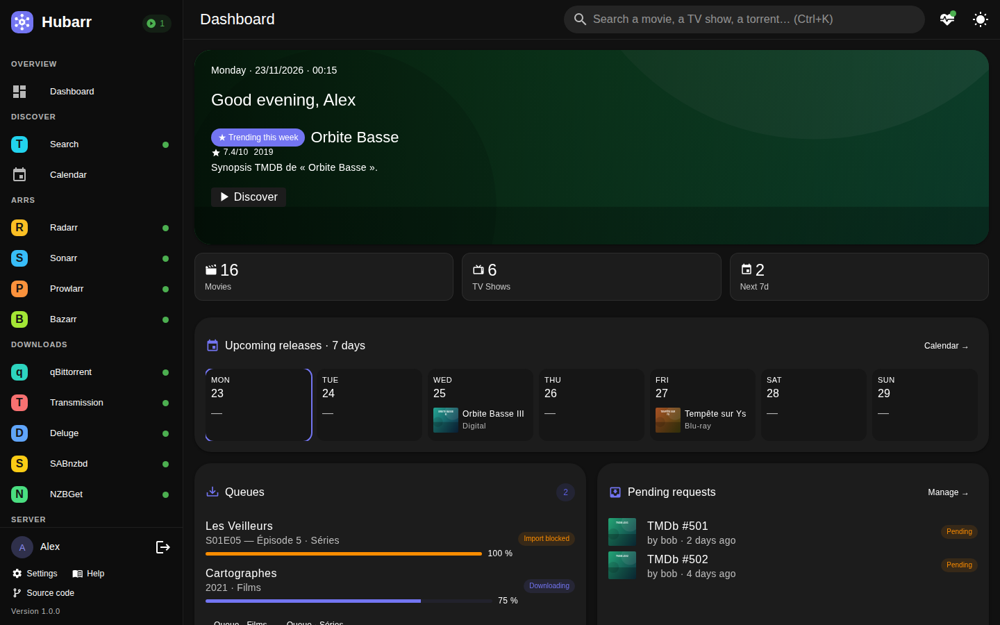

> Les captures montrent l'interface en anglais ; Hubarr est entièrement disponible en français.

## Pourquoi Hubarr ?

Une stack média compte vite une dizaine de services, chacun avec son interface, son mot de passe et sa logique, et la plupart se prêtent mal à un téléphone. Hubarr ne remplace aucun d'eux : il les **pilote par leurs API** et les réunit derrière **une seule interface et une seule connexion**.

- **Tout au même endroit** : 15 services, la même navigation partout, une recherche globale (`Ctrl+K`) sur vos bibliothèques et TMDB.
- **Pensé pour le mobile** : barre du bas, appui long pour sélectionner, tirer pour actualiser, installable comme une application (PWA).
- **Vue d'ensemble** : tableau de bord personnalisable, calendrier de toutes vos instances (avec flux iCal), santé des services en continu.
- **Administration complète** : profils de qualité, formats personnalisés, indexeurs, clients, notifications, tâches et journaux de Radarr, Sonarr et Prowlarr, sans changer d'onglet.
- **Temps réel** : téléchargements, files d'attente et lectures en cours mis à jour en direct, sans surcharger vos services.
- **Sûr à exposer** : le navigateur ne parle qu'à Hubarr ; adresses et clés des services restent côté serveur.
- **Léger** : une image Docker, une base SQLite, aucune dépendance externe.

## Services pris en charge

| Famille | Services |
| --- | --- |
| Bibliothèques | **Radarr**, **Sonarr** (plusieurs instances chacun) |
| Indexeurs et sous-titres | **Prowlarr**, **Bazarr** |
| Téléchargement | **qBittorrent**, **Transmission**, **Deluge**, **SABnzbd**, **NZBGet**, **Gluetun** (VPN) |
| Demandes | **Seerr** (Jellyseerr, Overseerr) |
| Activité | **Tautulli** (Plex), **Tracearr**, **Emby** |
| Découverte | **TMDB** (tendances, fiches, collections, watchlist) |

## Aperçu

| | |
| --- | --- |
| 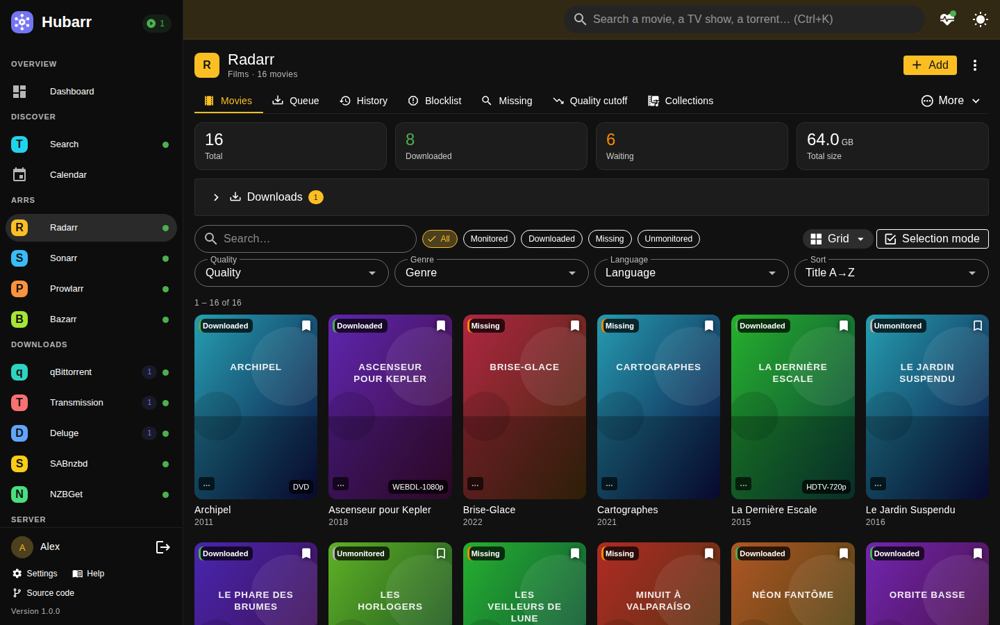 | 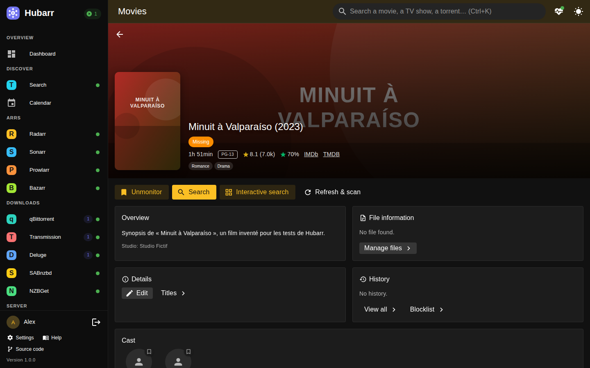 |
| **Bibliothèques** : grille, liste ou tableau, filtres, actions groupées | **Fiches** : fichiers, historique, recherche interactive de releases |
| 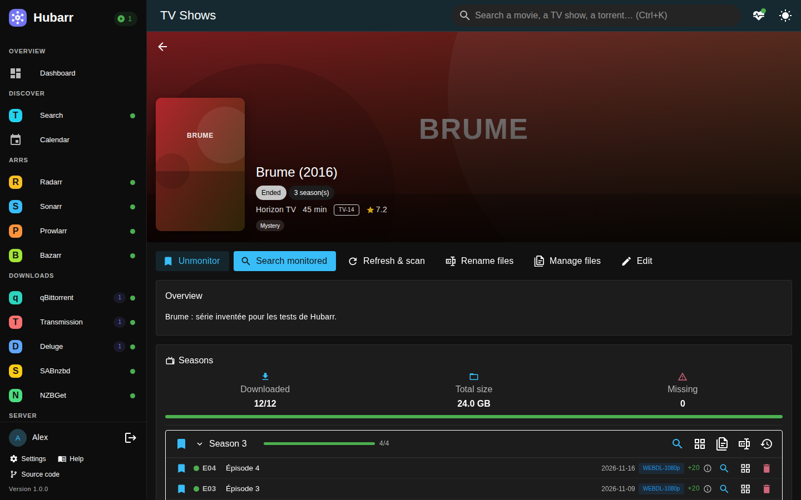 | 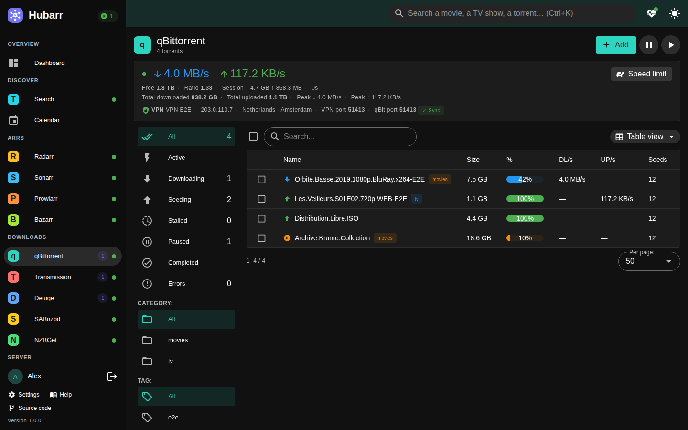 |
| **Séries** : saisons, épisodes, suivi | **Téléchargements** : une vue pour tous les clients torrent et Usenet |
| 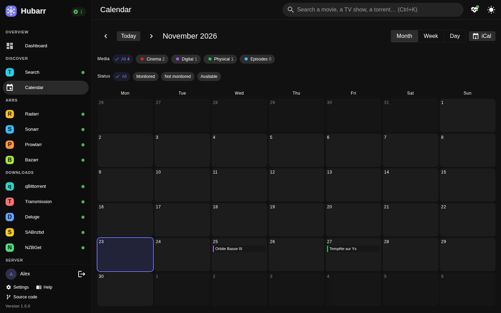 | 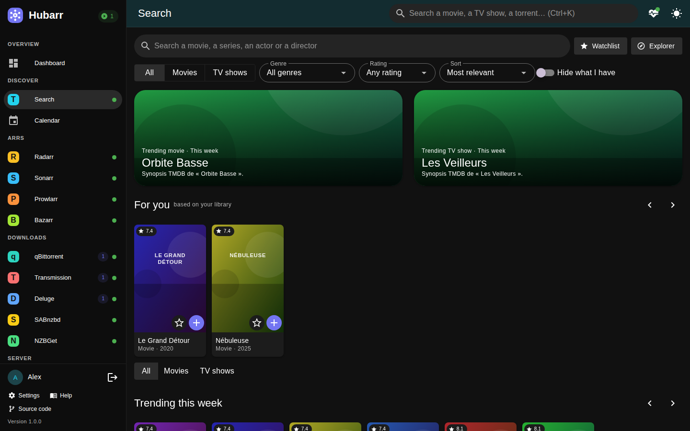 |
| **Calendrier** : sorties et diffusions de toutes les instances | **Découverte** : tendances TMDB, état dans vos bibliothèques |
| 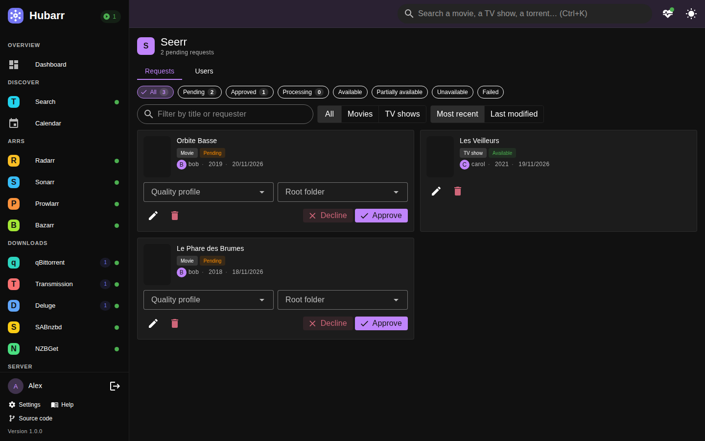 | 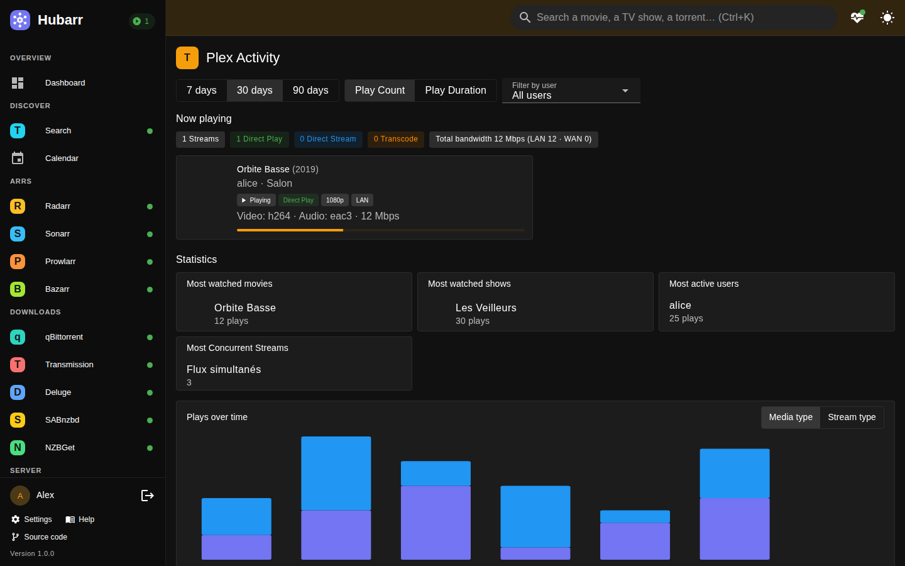 |
| **Demandes** : approuver, refuser, gérer les utilisateurs | **Activité** : lectures en cours, statistiques, graphiques |

### Sur mobile

<p align="center">
  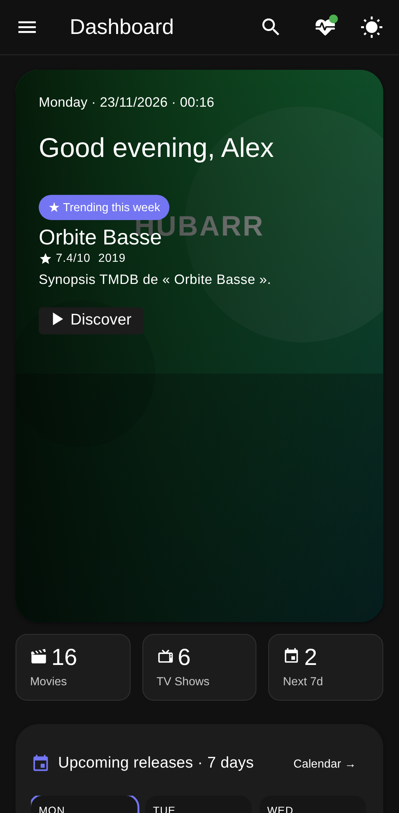
  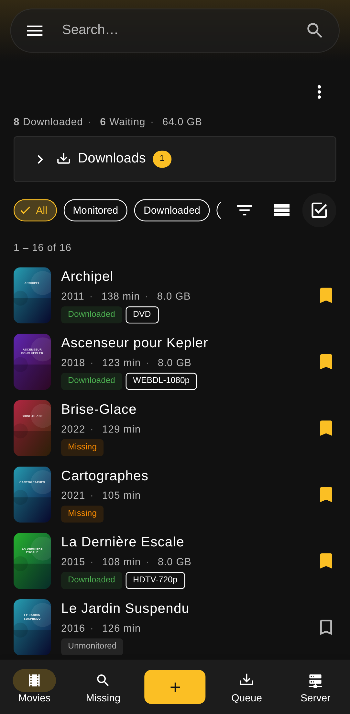
  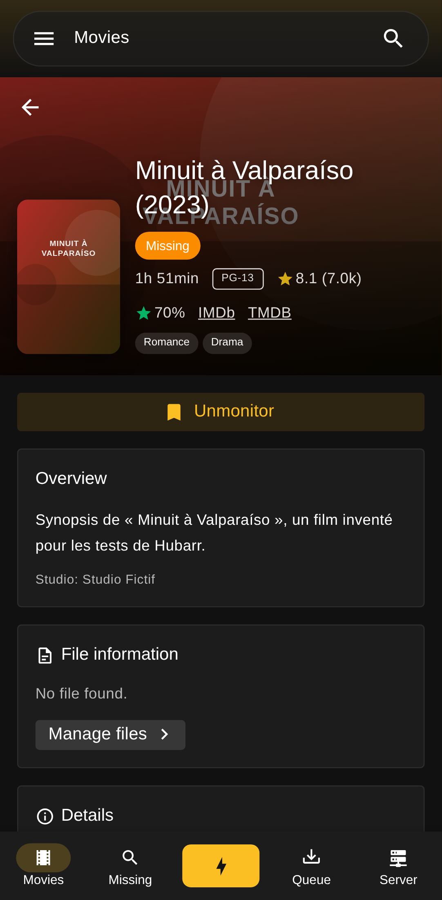
  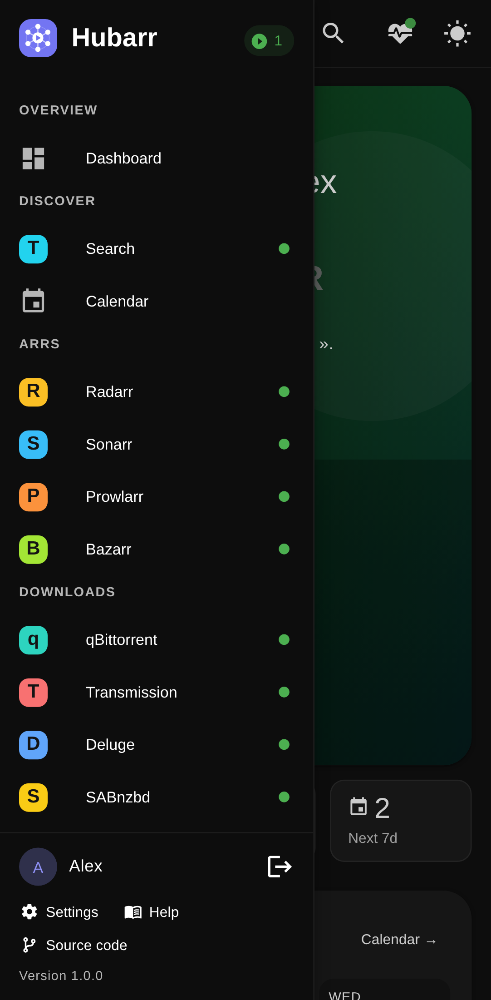
</p>

## Installation

L'image est publiée sur Docker Hub : [`naroner/hubarr`](https://hub.docker.com/r/naroner/hubarr) (amd64). Avec Docker Compose (voir [`docker-compose.example.yml`](docker-compose.example.yml)) :

```yaml
name: hubarr

services:
  hubarr:
    image: naroner/hubarr:latest
    container_name: hubarr
    restart: unless-stopped
    environment:
      TZ: Europe/Paris
      PUID: 1000
      PGID: 1000
    volumes:
      - hubarr_data:/data       # base, sauvegarde et avatars
    ports:
      - '7070:7070'

volumes:
  hubarr_data:
```

```sh
docker compose up -d
```

Ouvrez `http://<votre-serveur>:7070` : l'assistant crée le compte administrateur, puis vous connectez vos services depuis **Paramètres**. Pour un accès distant en HTTPS (sous-domaine ou chemin `/hubarr`), voir [Reverse proxy](docs/fr/reverse-proxy.md).

**Mise à jour** : `docker compose pull && docker compose up -d`. Les migrations s'appliquent au démarrage, après une copie de sauvegarde de la base ; l'application installée sur mobile suit la version de l'image. Sur une autre architecture, [construisez l'image depuis les sources](docs/fr/installation.md#construire-l-image-depuis-les-sources) (`make build`).

## Documentation

La documentation est embarquée dans l'image et servie par Hubarr sur **`/docs`** (lien **Aide** dans l'application). Les sources françaises sont dans [`docs/fr/`](docs/fr/) :

- [Présentation fonctionnelle](docs/fr/presentation.md) : rôles, notions, modules, règles de gestion ;
- [Installation](docs/fr/installation.md), [Premier démarrage](docs/fr/premier-demarrage.md), [Paramètres](docs/fr/parametres.md) ;
- [Reverse proxy et accès distant](docs/fr/reverse-proxy.md), [Application mobile](docs/fr/application-mobile.md), [Dépannage](docs/fr/depannage.md) ;
- une fiche par service (où trouver l'URL et la clé, pièges courants) ;
- [Architecture technique](docs/fr/architecture.md) et [Développer Hubarr](docs/fr/developpement.md).

## Sous le capot

Node.js 24, Fastify 5, zod, Drizzle ORM et SQLite côté serveur ; Vue 3, Vuetify 4, TanStack Query et vue-i18n côté interface ; TypeScript strict de bout en bout, contrats partagés entre serveur et interface. Tests Vitest et Playwright (desktop et mobile) contre l'image de production. Détails dans l'[architecture technique](docs/fr/architecture.md).

## Contribuer

Tout l'outillage tourne dans Docker : `make hooks` puis `make dev`. Le guide est dans [Développer Hubarr](docs/fr/developpement.md) ; les versions sont listées dans le [CHANGELOG](CHANGELOG.md).

## Licence et crédits

Hubarr est un logiciel libre sous licence [GNU AGPL v3.0 ou ultérieure](LICENSE). Il s'inspire de [Prismarr](https://github.com/Shoshuo/Prismarr), dont il reprend et adapte certains éléments : voir [`NOTICE.md`](NOTICE.md).

Les noms des services cités sont des marques de leurs propriétaires respectifs ; Hubarr n'est affilié à aucun de ces projets.
