<p align="center">
  
</p>

<h1 align="center">Hubarr</h1>

<p align="center">
  <strong>Your media stack, in one place.</strong><br />
  Radarr, Sonarr, Prowlarr, Bazarr, Seerr, download clients, Tautulli, Emby… driven from a single interface, on your phone as on your desktop.
</p>

<p align="center">
  <a href="LICENSE"></a>
  <a href="https://hub.docker.com/r/naroner/hubarr"></a>
  
</p>

<p align="center"><a href="README.fr.md">Version française</a></p>

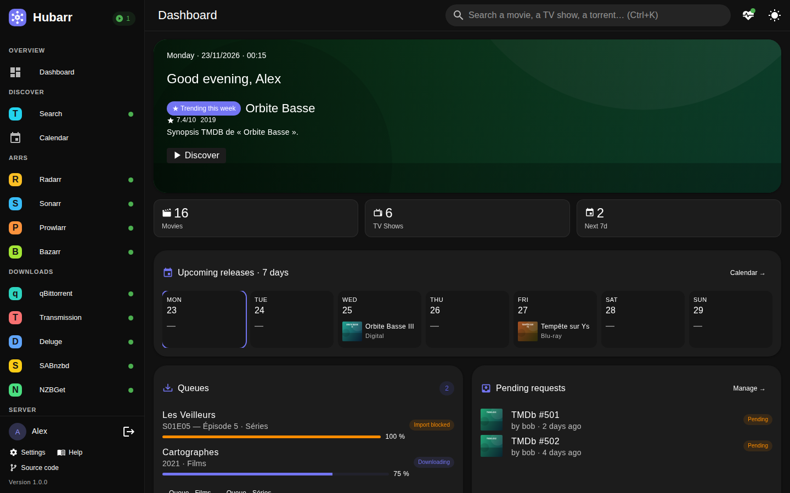

## Why Hubarr?

A media stack quickly grows to a dozen services, each with its own interface, password and logic, and most are awkward on a phone. Hubarr replaces none of them: it **drives them through their APIs** and brings them together behind **one interface and one login**.

- **Everything in one place**: 15 services, the same navigation everywhere, a global search (`Ctrl+K`) across your libraries and TMDB.
- **Built for mobile**: bottom bar, long press to select, pull to refresh, installable as an app (PWA).
- **The big picture**: customizable dashboard, calendar of all your instances (with an iCal feed), continuous service health.
- **Full administration**: quality profiles, custom formats, indexers, clients, notifications, tasks and logs of Radarr, Sonarr and Prowlarr, without switching tabs.
- **Real time**: downloads, queues and active streams update live, without hammering your services.
- **Safe to expose**: the browser only talks to Hubarr; service addresses and keys stay on the server.
- **Lightweight**: one Docker image, one SQLite database, no external dependency.

## Supported services

| Family | Services |
| --- | --- |
| Libraries | **Radarr**, **Sonarr** (several instances each) |
| Indexers and subtitles | **Prowlarr**, **Bazarr** |
| Downloads | **qBittorrent**, **Transmission**, **Deluge**, **SABnzbd**, **NZBGet**, **Gluetun** (VPN) |
| Requests | **Seerr** (Jellyseerr, Overseerr) |
| Activity | **Tautulli** (Plex), **Tracearr**, **Emby** |
| Discover | **TMDB** (trends, details, collections, watchlist) |

## Preview

| | |
| --- | --- |
| 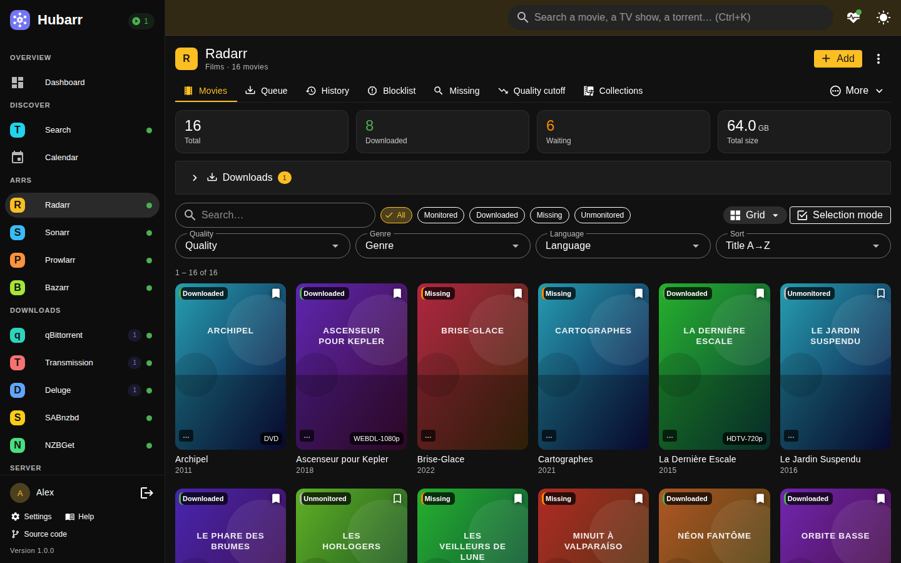 | 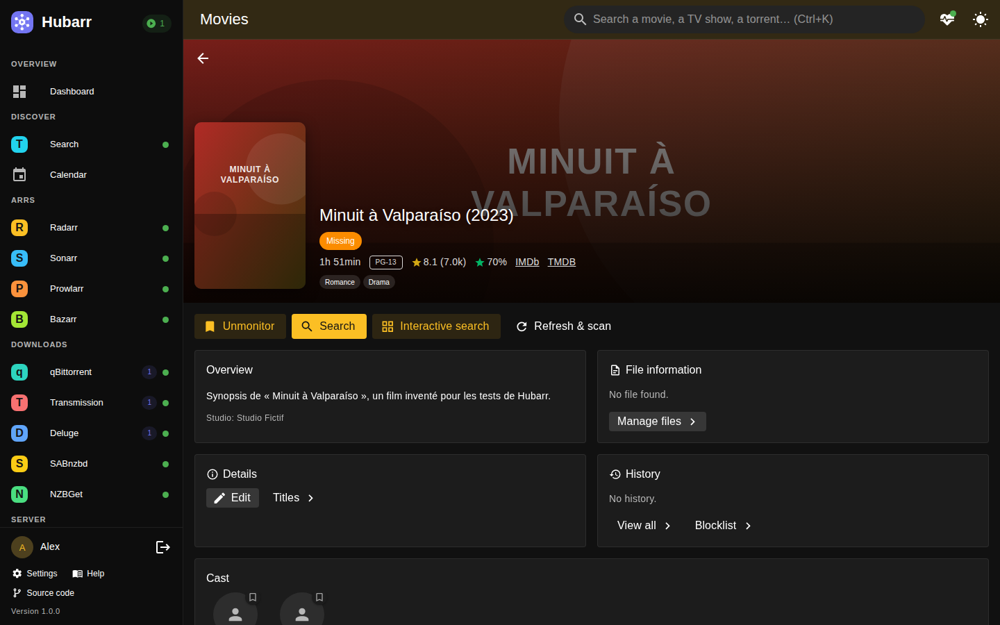 |
| **Libraries**: grid, list or table, filters, bulk actions | **Detail pages**: files, history, interactive release search |
| 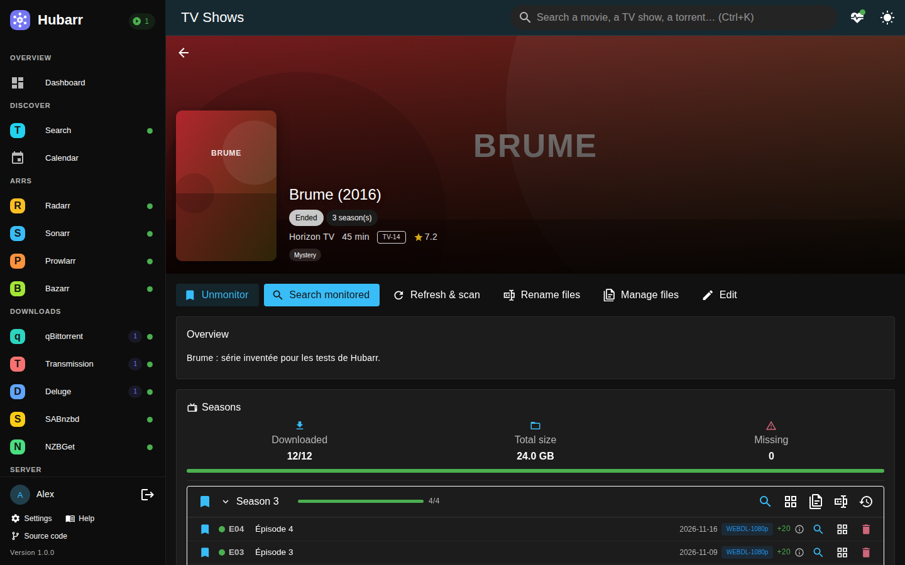 | 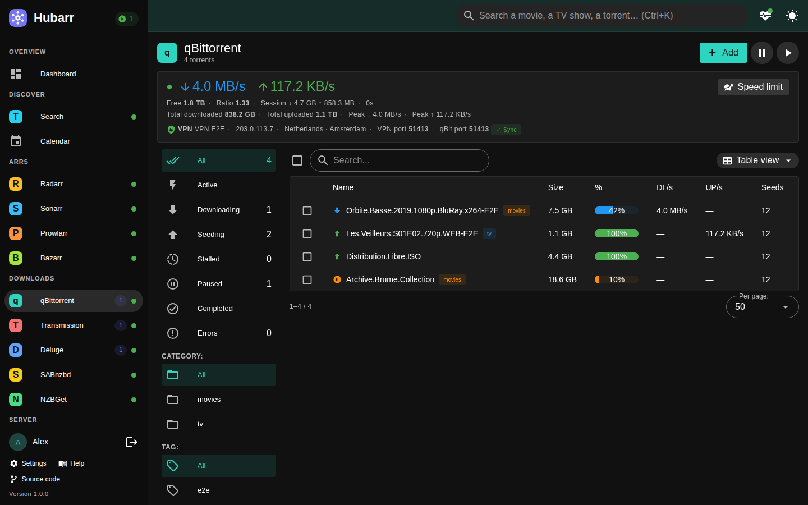 |
| **Shows**: seasons, episodes, monitoring | **Downloads**: one view for every torrent and Usenet client |
| 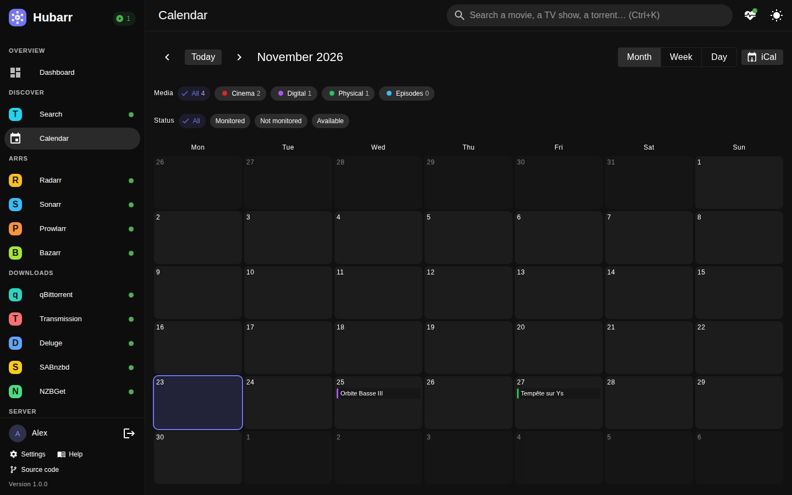 | 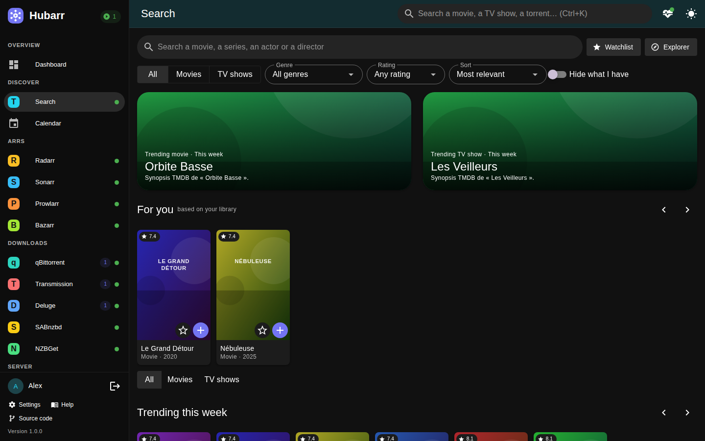 |
| **Calendar**: releases and air dates from every instance | **Discover**: TMDB trends, state in your libraries |
| 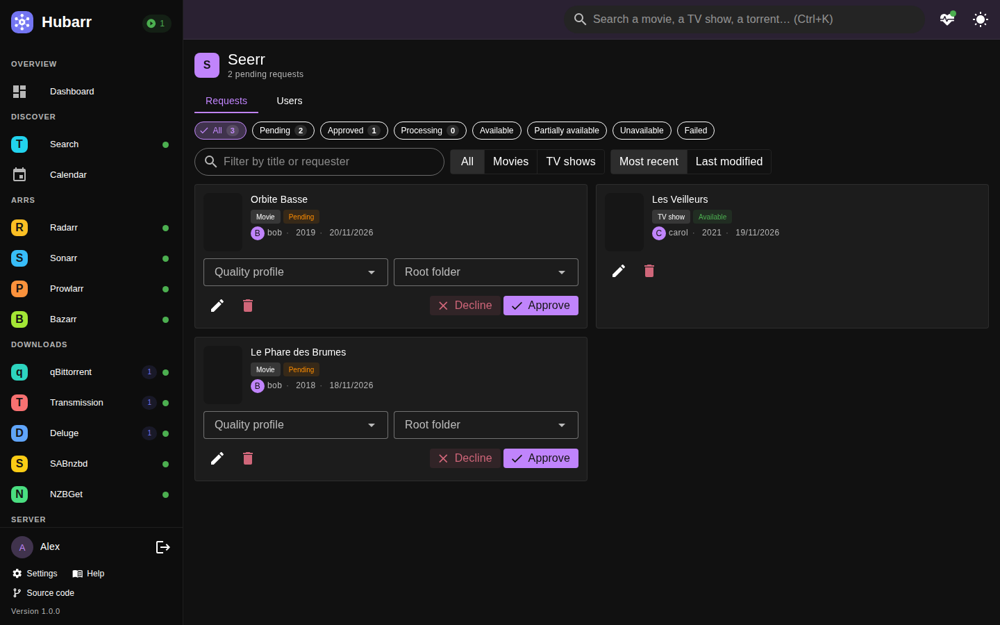 | 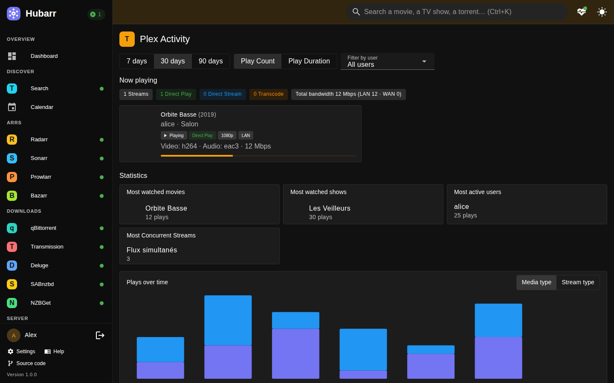 |
| **Requests**: approve, decline, manage users | **Activity**: active streams, statistics, charts |

### On mobile

<p align="center">
  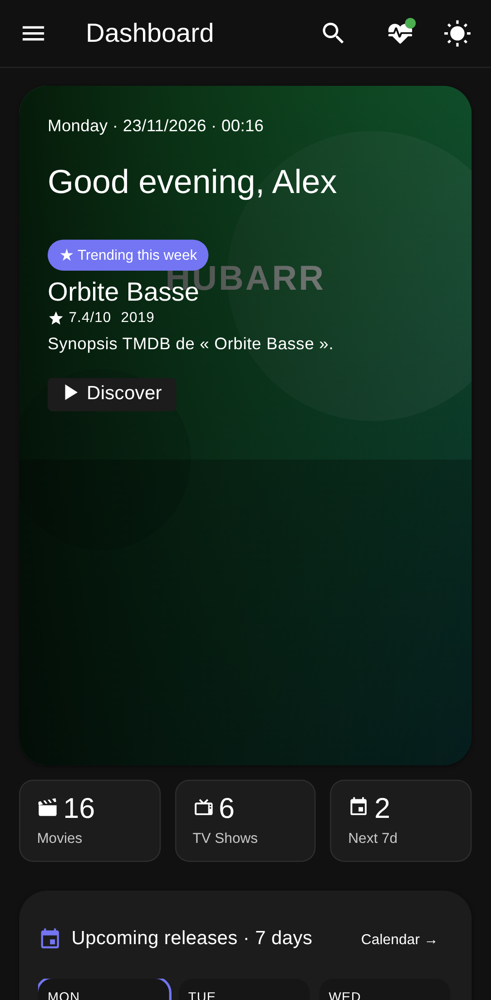
  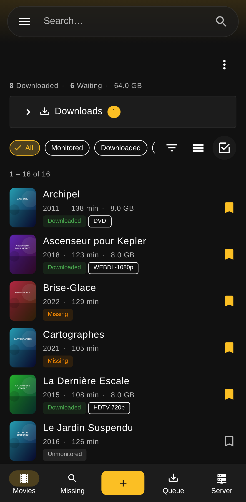
  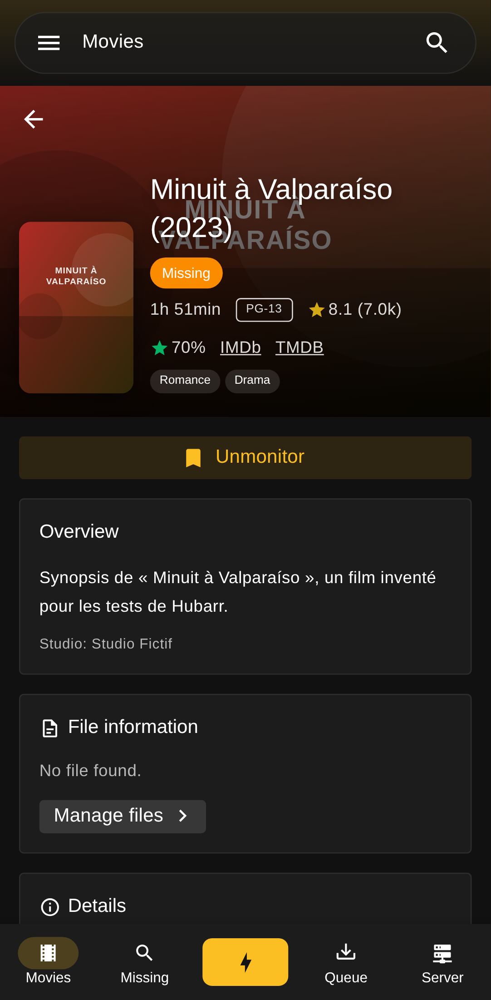
  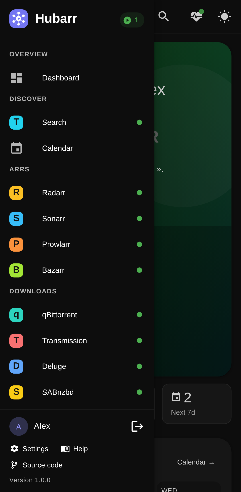
</p>

## Installation

The image is published on Docker Hub: [`naroner/hubarr`](https://hub.docker.com/r/naroner/hubarr) (amd64). With Docker Compose (see [`docker-compose.example.yml`](docker-compose.example.yml)):

```yaml
name: hubarr

services:
  hubarr:
    image: naroner/hubarr:latest
    container_name: hubarr
    restart: unless-stopped
    environment:
      TZ: Europe/Paris
      PUID: 1000
      PGID: 1000
    volumes:
      - hubarr_data:/data       # database, backup and avatars
    ports:
      - '7070:7070'

volumes:
  hubarr_data:
```

```sh
docker compose up -d
```

Open `http://<your-server>:7070`: the wizard creates the administrator account, then you connect your services from **Settings**. For remote HTTPS access (subdomain or `/hubarr` path), see [Reverse proxy](docs/reverse-proxy.md).

**Updating**: `docker compose pull && docker compose up -d`. Migrations run at startup, after a backup copy of the database; the app installed on mobile follows the image version. On another architecture, [build the image from source](docs/installation.md#building-the-image-from-source) (`make build`).

## Documentation

The documentation is embedded in the image and served by Hubarr at **`/docs`** (**Help** link in the app). Sources live in [`docs/`](docs/) (French under [`docs/fr/`](docs/fr/)):

- [Functional overview](docs/overview.md): roles, concepts, modules, business rules;
- [Installation](docs/installation.md), [First start](docs/first-start.md), [Settings](docs/settings.md);
- [Reverse proxy and remote access](docs/reverse-proxy.md), [Mobile app](docs/mobile-app.md), [Troubleshooting](docs/troubleshooting.md);
- one page per service (where to find the URL and key, common pitfalls);
- [Technical architecture](docs/architecture.md) and [Developing Hubarr](docs/development.md).

## Under the hood

Node.js 24, Fastify 5, zod, Drizzle ORM and SQLite on the server; Vue 3, Vuetify 4, TanStack Query and vue-i18n in the interface; strict TypeScript end to end, with contracts shared between server and interface. Vitest and Playwright tests (desktop and mobile) against the production image. Details in the [technical architecture](docs/architecture.md).

## Contributing

All tooling runs in Docker: `make hooks` then `make dev`. The guide is in [Developing Hubarr](docs/development.md); releases are listed in the [CHANGELOG](CHANGELOG.md).

## License and credits

Hubarr is free software under the [GNU AGPL v3.0 or later](LICENSE). It is inspired by [Prismarr](https://github.com/Shoshuo/Prismarr), from which it reuses and adapts some elements: see [`NOTICE.md`](NOTICE.md).

The service names mentioned are trademarks of their respective owners; Hubarr is not affiliated with any of these projects.
