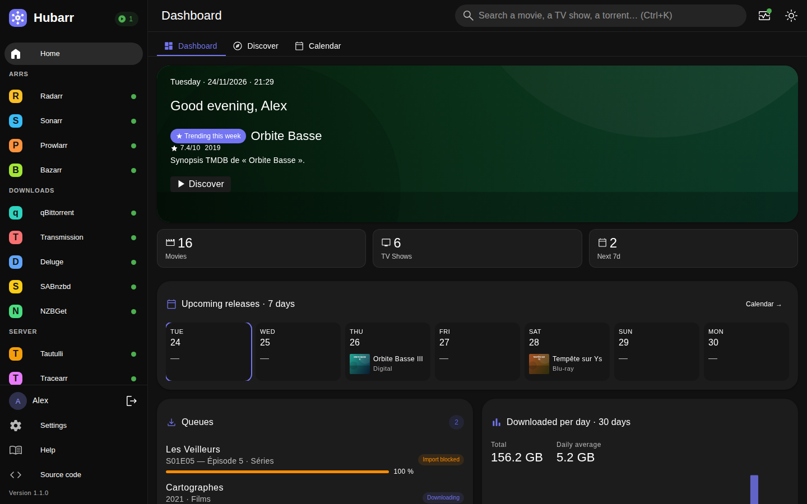

<p align="center">
  
</p>

<h1 align="center">Hubarr</h1>

<p align="center">
  <strong>Your media stack, in one place.</strong><br />
  Radarr, Sonarr, Prowlarr, Bazarr, Seerr, download clients, Tautulli, Emby… driven from a single interface, on your phone as on your desktop.
</p>



Hubarr is a self-hosted web app that drives your media services through their APIs and brings them together behind **one interface and one login**: libraries, indexers, subtitles, downloads, requests, playback activity and discovery. Mobile-first, installable as an app (PWA), in English and French.

- **Source code and documentation**: <https://github.com/KilianMahe/hubarr>
- **Changelog**: <https://github.com/KilianMahe/hubarr/blob/main/CHANGELOG.md>
- **License**: AGPL-3.0-or-later

## Supported services

| Family                 | Services                                                                                  |
| ---------------------- | ----------------------------------------------------------------------------------------- |
| Libraries              | **Radarr**, **Sonarr** (several instances each)                                           |
| Indexers and subtitles | **Prowlarr**, **Bazarr**                                                                  |
| Downloads              | **qBittorrent**, **Transmission**, **Deluge**, **SABnzbd**, **NZBGet**, **Gluetun** (VPN) |
| Requests               | **Seerr** (Jellyseerr, Overseerr)                                                         |
| Activity               | **Tautulli** (Plex), **Tracearr**, **Emby**                                               |
| Discover               | **TMDB**                                                                                  |

## Quick start

```yaml
name: hubarr

services:
  hubarr:
    image: naroner/hubarr:latest
    container_name: hubarr
    restart: unless-stopped
    environment:
      TZ: Europe/Paris
      PUID: 1000
      PGID: 1000
    volumes:
      - hubarr_data:/data
    ports:
      - '7070:7070'

volumes:
  hubarr_data:
```

```sh
docker compose up -d
```

Open `http://<your-server>:7070`: the setup wizard creates the administrator account, then connect your services from **Settings**. The full documentation is embedded in the image and served at `/docs`.

**Update**: `docker compose pull && docker compose up -d`. Database migrations run at startup after a backup copy; an installed PWA follows the image version.

## Tags

| Tag                    | Content                              |
| ---------------------- | ------------------------------------ |
| `latest`               | Latest release                       |
| `x.y.z` (e.g. `1.0.0`) | A specific release, to pin a version |

Images are built for **linux/amd64**. For another architecture, build from source (`make build`, see the repository).

## Environment variables

| Variable                  | Default                          | Purpose                                                                                        |
| ------------------------- | -------------------------------- | ---------------------------------------------------------------------------------------------- |
| `PUID`, `PGID`            | `1000`                           | User and group owning the files in `/data`; the server runs under this identity, never as root |
| `TZ`                      | `UTC`                            | Default display time zone and log time zone                                                    |
| `HUBARR_LOG_LEVEL`        | `warn`                           | `fatal`, `error`, `warn`, `info`, `debug` or `trace`                                           |
| `HUBARR_LOG_BUFFER_LEVEL` | _(same as `HUBARR_LOG_LEVEL`)_   | Minimum level kept for the in-app **Logs** page (`info` keeps more detail there)               |
| `HUBARR_BASE_PATH`        | _(empty)_                        | Path prefix behind a reverse proxy that forwards the full path (`/hubarr`)                     |
| `HUBARR_TRUST_PROXY`      | `loopback,linklocal,uniquelocal` | Trusted reverse proxies (`X-Forwarded-*`, `X-Forwarded-Prefix`)                                |
| `HUBARR_FRAME_ANCESTORS`  | _(empty)_                        | Origins allowed to embed Hubarr in an iframe                                                   |
| `HUBARR_PORT`             | `7070`                           | Listening port inside the container                                                            |

**Volume**: `/data` holds the SQLite database, its automatic backup and the avatars. **Port**: `7070`. **Health check**: built in (`/api/health`).

## Credits

Hubarr is inspired by [Prismarr](https://github.com/Shoshuo/Prismarr). Service names are trademarks of their respective owners; Hubarr is not affiliated with any of these projects.
